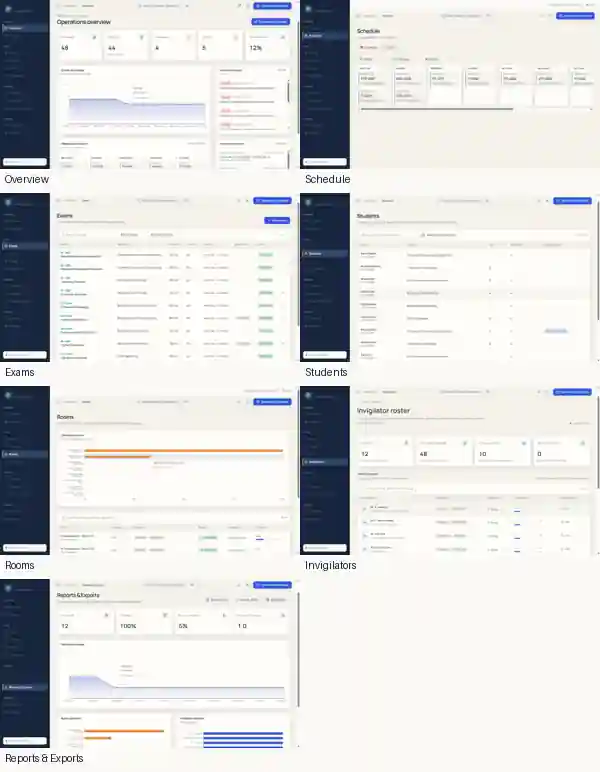
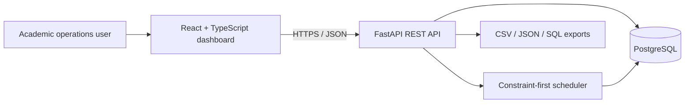

# ExamFlow

**Intelligent examination scheduling for university operations.**

ExamFlow helps academic teams organise examinations, allocate rooms, assign invigilators and review scheduling constraints from one workspace. It combines a React operations dashboard with a FastAPI scheduling service and PostgreSQL.

[](https://examflow-theta.vercel.app)
[](https://examflow-api-f24k.onrender.com/docs)


Application : https://examflow-theta.vercel.app/
Email : admin@examflow.demo
Password : mls4zw1c_B8FQ1nn7l8Kju7o


## Product screenshots

The screenshots below show the main ExamFlow workspace and its core operational pages.




| Screen | What it shows |
|---|---|
| **Overview** | Exam coverage, scheduled and unassigned counts, conflicts, room utilisation and recent audit activity. |
| **Schedule** | Calendar and table views of exam assignments, with date, status and room filters. |
| **Exams** | Exam catalogue with department, duration, enrollment, scheduling window, requirements and status. |
| **Students** | Student directory, programme, year, enrollment count and accommodation indicators. |
| **Rooms** | Room capacity, equipment, accessibility, availability and utilisation. |
| **Invigilators** | Staff roster, qualifications, availability, duty allocation and conflict status. |
| **Reports & Exports** | Session coverage, room utilisation, invigilator workload, and CSV, JSON and SQL export actions. |

## Product overview

Exam scheduling is constraint-heavy: a timetable must avoid student clashes, respect room capacity and availability, match equipment and accessibility requirements, and assign available invigilators. ExamFlow evaluates these constraints before accepting assignments.

- **Manage academic data:** students, courses, enrollments, exams, rooms and invigilators.
- **Generate schedules:** build exam timetables across a configured date and time window.
- **Allocate resources:** check capacity, equipment, accessibility, room closures and staff availability.
- **Apply accommodations:** support extended time and dedicated-room allocation where required.
- **Review exceptions:** show unassigned exams with explicit reason codes.
- **Validate and audit:** inspect hard-constraint results and retain schedule-run/event history.
- **Export results:** download schedule and database outputs in supported formats.

## Live product

- [Overview](https://examflow-theta.vercel.app/)
- [Schedule](https://examflow-theta.vercel.app/schedule)
- [Exams](https://examflow-theta.vercel.app/exams)
- [Students](https://examflow-theta.vercel.app/students)
- [Rooms](https://examflow-theta.vercel.app/rooms)
- [Invigilators](https://examflow-theta.vercel.app/invigilators)
- [Conflicts](https://examflow-theta.vercel.app/conflicts)
- [Validation](https://examflow-theta.vercel.app/validation)
- [Reports & Exports](https://examflow-theta.vercel.app/reports)
- [Audit Trail](https://examflow-theta.vercel.app/audit)

## Scheduling constraints

| Constraint | Expected behaviour |
|---|---|
| Student conflicts | Prevent overlapping exams for the same student. |
| Room capacity | Do not allocate a cohort beyond usable room capacity. |
| Room availability | Exclude rooms during closure or unavailable periods. |
| Equipment and accessibility | Match room facilities to exam requirements and accommodations. |
| Invigilator availability | Prevent unavailable or double-booked staff assignments. |
| Invigilator workload | Respect configured duty limits. |
| Accommodations | Apply supported timing and separate-room requirements consistently. |
| Unresolved constraints | Leave the exam unassigned and record a reason. |

The validator checks student, room and invigilator conflicts. Separate-room accommodation can place the accommodated student in a dedicated room and the remaining cohort in a main room, with invigilation coverage for each room.

## Workflow

1. Prepare students, courses, enrollments, exams, rooms, staff and accommodation data.
2. Configure the examination window and operating hours.
3. Generate the timetable.
4. Review assignments and unassigned reasons.
5. Run independent validation.
6. Inspect audit history and export the results.

## Architecture



| Layer | Technology |
|---|---|
| Frontend | React, TypeScript, TanStack Router/Query |
| UI | Tailwind CSS, shadcn/ui, Radix UI, Lucide |
| Backend | Python, FastAPI, Pydantic |
| Persistence | SQLAlchemy, PostgreSQL (hosted), SQLite (local default) |
| Tests | Pytest, FastAPI TestClient, Vitest |
| Hosting | Vercel, Render, Neon |

## Data model

Core entities include Student, Course, Enrollment, Exam, ExamCourse, ExamRequirement, Room, RoomCapacity, Invigilator, Availability, Accommodation, ScheduleAssignment, ScheduleRun and ScheduleEvent.

Identifiers use consistent formats such as `STU-000001`, `EXAM-2026-000001`, `ROOM-000001` and `INV-000001`. Dataset regeneration preserves prior schedule-run and event history. Ground-truth labels are kept separate from scheduling inputs.

## Synthetic dataset and reproducibility

The documented full-scale dataset target is:

- **5,000 students**
- **300 exams**
- **100 rooms**
- **200 invigilators**

A fixed seed supports repeatable generation. Evaluation scenarios cover overlapping student exams, insufficient room capacity, room closures, invigilator conflicts and accommodation cases. Ground-truth labels are exported separately from solver inputs. Dataset exports include CSV/JSON data, SQL snapshots, generator metadata, provenance and reproducibility checksums.

## Run locally

### Requirements

- Python 3.10+
- Node.js 20+
- Bun (recommended)

### Backend

```bash
python -m venv .venv
# Windows PowerShell: .venv\\Scripts\\Activate.ps1
# macOS/Linux: source .venv/bin/activate
pip install -r requirements.txt
uvicorn app.main:app --reload --port 8000
```

API docs: [http://localhost:8000/docs](http://localhost:8000/docs).

### Frontend

In a second terminal:

```bash
bun install
cp .env.example .env
bun run dev
```

On Windows, copy `.env.example` to `.env` manually if `cp` is unavailable. Set `VITE_API_BASE_URL` to the backend API base URL (normally `http://localhost:8000/api/v1`).

### Generate a dataset

```bash
curl -X POST http://localhost:8000/api/v1/datasets/generate \
  -H "Content-Type: application/json" \
  -d '{"seed":20261111,"students":5000,"exams":300,"rooms":100,"invigilators":200,"include_edge_cases":false}'
```

Generate a schedule from the dashboard or use `POST /api/v1/schedules/generate`. For the complete endpoint list, open the [API documentation](https://examflow-api-f24k.onrender.com/docs).

## Verification and project docs

- [GitHub Actions](https://github.com/bunnybhuvan/ExamFlow/actions)
- [Problem statement traceability](./docs/PROBLEM_STATEMENT_TRACEABILITY.md)
- [Scheduling algorithm](./docs/ALGORITHM.md)
- [Demo walkthrough](./docs/DEMO.md)
- [Deployment guide](./docs/DEPLOYMENT.md)
- [AI usage record](./docs/AI_USAGE.md)

Run backend tests with `pytest` and frontend tests with `bun run test`.

## Deployment and scope

- Frontend: [examflow-theta.vercel.app](https://examflow-theta.vercel.app)
- Backend: [examflow-api-f24k.onrender.com](https://examflow-api-f24k.onrender.com)
- API docs: [Swagger UI](https://examflow-api-f24k.onrender.com/docs)

The hosted demo uses free-tier services and may experience cold starts or provider usage limits. ExamFlow is a challenge/portfolio demonstrator, not a certified institutional SIS or a service with guaranteed uptime.

## License

No open-source license has been declared in this repository. Contact the repository owner before redistributing or reusing the project beyond permissions granted by GitHub.
